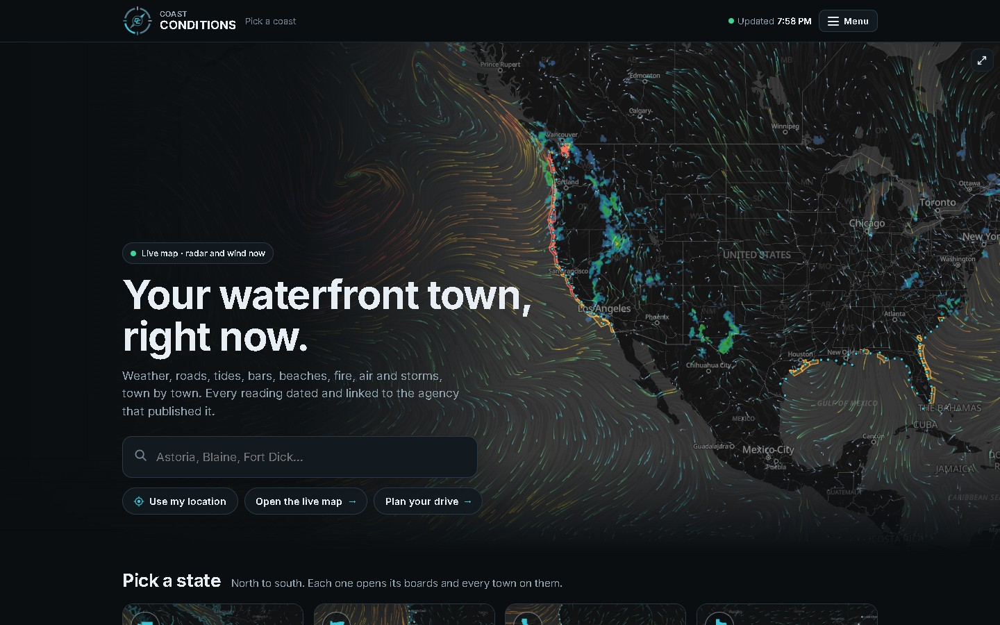
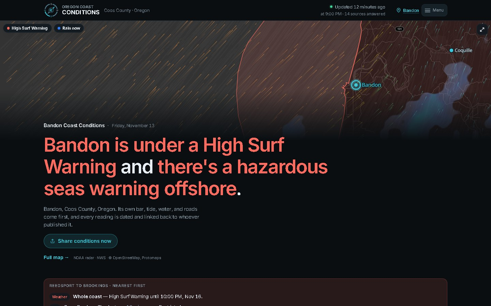
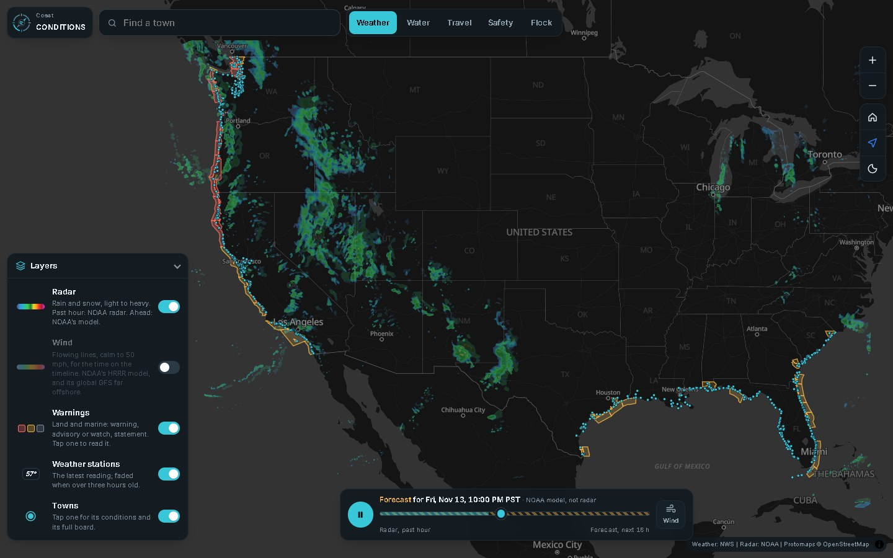
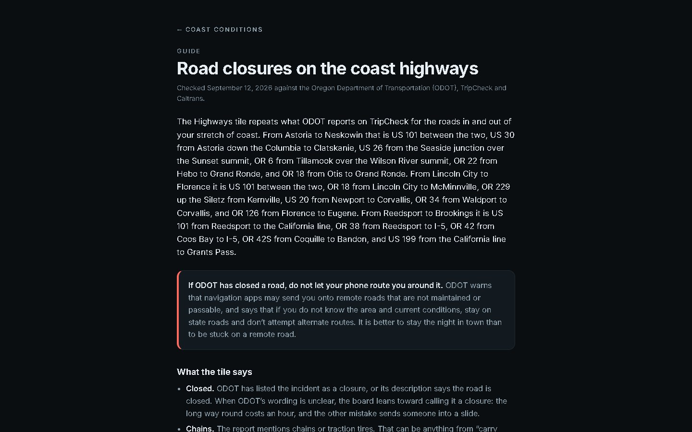
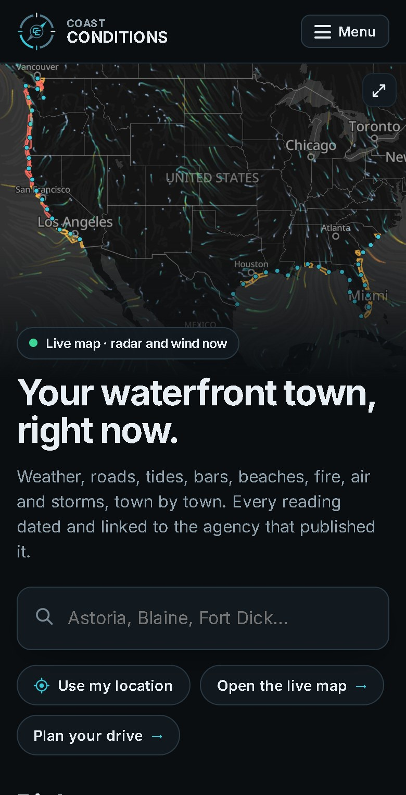

# Coast Conditions

Live weather, roads, tides, bar reports, beaches, fire, air quality and storm alerts for waterfront towns along the U.S. coast, town by town. Designed and built by [Rooted Coast Design](https://www.rootedcoastdesign.com).

**Live:** https://coastconditions.com

> This repository is a product overview. The source code is private.

## What it does

- **A board for every coastal town.** One page per town brings together the forecast, road closures, tides, harbor bar conditions, beach advisories, fire danger, air quality and active warnings.
- **Every reading has a source.** Each item is dated and linked to the public agency that published it, such as the National Weather Service, state transportation departments and state health departments.
- **A live map.** Radar, wind and warnings across the country, with layers that can be turned on and off.
- **Trip planning.** Road closures and conditions along a planned drive.
- **Coverage.** Towns in 21 coastal states, from Washington to Maine.

## Screens

| Town board | Live map |
|---|---|
|  |  |

| Road closures | On a phone |
|---|---|
|  |  |

## How it works

- **Static pages, refreshed on a schedule.** Town and state pages are generated ahead of time and rebuilt by scheduled GitHub Actions, so pages load fast and the sources are not hit on every visit.
- **Serverless functions.** Vercel functions fetch, check and combine agency data, and refresh boards on demand.
- **Per-source parsers with tests.** Each agency feed has its own parser, tested against saved real responses.
- **Generated share images.** Each board gets a share card drawn on the server from its current conditions.

## Built with

| Area | Used here |
|---|---|
| Pages | Static HTML, CSS and JavaScript, generated by Node.js scripts |
| Functions and storage | Vercel functions and Vercel Blob |
| Scheduling | GitHub Actions |
| Images | Satori and resvg |
| Notifications | Web push |

## About this repository

The code for Coast Conditions is private. This page exists to show what the product does and how it is built. For questions, contact [hello@rootedcoastdesign.com](mailto:hello@rootedcoastdesign.com).

© Rooted Coast Design LLC. All rights reserved.
